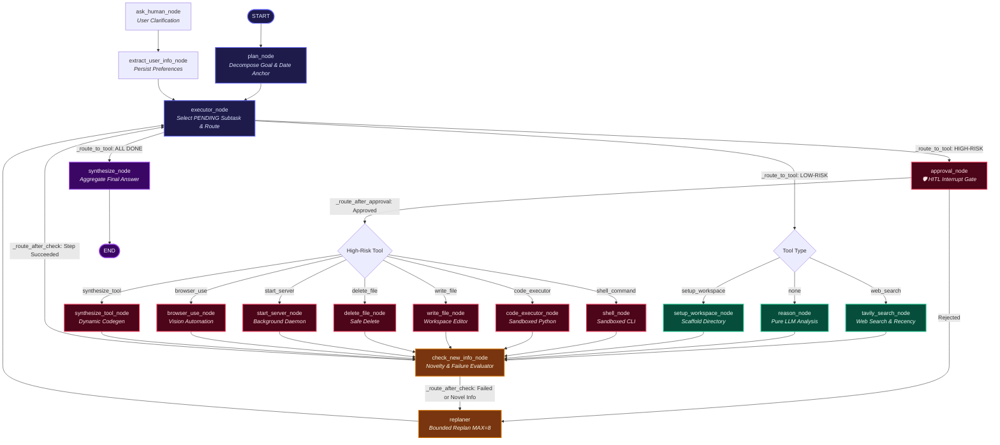

# Plan-and-Execute Agent

A Plan-and-Execute agent with dynamic tool synthesis, benchmarked against a plain
ReAct baseline via a controlled three-arm ablation.

**Status:** Phase 9 Complete — Claude-like Chat Interface ✅

## Build Progress
- **Phase 0** ✅ LangGraph & Tool-Calling Prereq
- **Phase 1** ✅ Planner + Step Schema
- **Phase 2** ✅ Executor + Fixed Tool Layer
- **Phase 3** ✅ Replanner + Termination Logic (Arm 2 complete)
- **Phase 4** ✅ Dynamic Tool Synthesis
- **Phase 5** ✅ Sandbox Hardening
- **Phase 6** ✅ Human-in-the-Loop Approval Gates
- **Phase 7** ✅ Browser Automation (Vision capabilities with OpenRouter Gemma integration)
- **Phase 8** ✅ ReAct Baseline + Ablation (Arm 1)
- **Phase 9** ✅ Web UI + Deployment (Chat interface + Debugger mode)

## Recent Enhancements
- **Interactive Node & Flow Visualizer**: Standalone web application to simulate and explore all 19 LangGraph nodes, routing edges, HITL approval gates, and state reducers ([Interactive Visualizer](docs/interactive_flow_visualizer.html))
- **Improved Replanning Logic**: Added `check_new_info_node` for novelty detection and optimized replanning efficiency
- **Increased Replan Capacity**: Raised `MAX_REPLAN` from 4 to 8 for handling complex multi-step tasks
- **Enhanced Chat Interface**: Real-time WebSocket streaming, improved interrupt handling, activity indicators
- **Run Visualizer**: Comprehensive API and runner implementation for step tracking and visualization
- **Cheap LLM Integration**: Added support for cost-effective LLM models with step result verification
- **Simplified Startup**: Added `start.sh` script for launching both frontend and backend servers

## Architecture & Interactive Flow Diagram

- ⚡ **[Interactive Flow Visualizer](docs/interactive_flow_visualizer.html)** — Full-featured interactive visualizer with scenario simulation, step-by-step state inspection, node registry directory, and state reducer lifecycle.
- 📐 **[Project Spec](docs/plan-and-execute-agent.html)** — Problem definition, scope, stack, timeline, and risk analysis.
- 🔌 **[System Wiring](docs/system-wiring.html)** — Step-by-step flows and wire diagrams for every subsystem.
- 🛠️ **[Tool Definitions](docs/TOOL_DEFINITIONS.md)** — Comprehensive reference for all tool schemas and parameters.

### Agent Flow & State Machine



### Graph Node Directory & Responsibilities

| Node Name | Subsystem | Risk Level | Primary Responsibility |
|:---|:---|:---|:---|
| **`plan_node`** | Planning | LOW | Decomposes user goal into structured subtasks with `Step` schemas; anchors dates. |
| **`executor_node`** | Control Flow | LOW | Selects the next `PENDING` subtask, marks it `RUNNING`, assembles cumulative state context, and routes to tool. |
| **`approval_node`** | Safety / HITL | GATE | Interrupt gate for human confirmation before executing high-risk operations (shell, file modifications, code execution, browser automation). |
| **`tavily_search_node`** | Fixed Tool | LOW | Real-time web search with domain allowlisting, relevance checks, and date filtering. |
| **`reason_node`** | Fixed Tool | LOW | LLM-based pure reasoning & deduction when `tool_hint="none"`, using prior step results. |
| **`setup_workspace_node`** | Coding Agent | LOW | Initializes an isolated sandboxed directory for project generation. |
| **`code_executor_node`** | Coding Agent | HIGH | Sandboxed Python code runner with timeout (15s), memory cap (256MB), and network guards. |
| **`shell_node`** | Coding Agent | HIGH | Sandboxed shell runner for CLI operations (npm, git). Explicitly blocks `rm`. |
| **`write_file_node`** | Coding Agent | HIGH | Writes or updates code, markdown, and config files in the active workspace. |
| **`delete_file_node`** | Coding Agent | HIGH | Safely deletes target files in the workspace (secure replacement for shell `rm`). |
| **`start_server_node`** | Coding Agent | HIGH | Starts background development web servers and registers `server_url` in state. |
| **`browser_use_node`** | Automation | HIGH | Vision-based browser automation (Chromium + OpenRouter Gemma-4-26B) for interactive web flows. |
| **`synthesize_tool_node`** | Dynamic Tooling | HIGH | 2-step dynamic Python tool synthesizer (declare schema → generate code → sandbox validate → registry cache). |
| **`check_new_info_node`** | Replanning | LOW | Evaluates step outcomes for failure recovery or novel information that warrants adaptive replanning. |
| **`replaner`** | Replanning | LOW | Dynamically rewrites remaining subtasks while preserving completed work (bounded by `MAX_REPLAN=8`). |
| **`ask_human_node`** | HITL | LOW | Interrupts execution to ask the user clarifying questions when key parameters are missing. |
| **`extract_user_info_node`**| HITL | LOW | Extracts user answers and persists them in the user profile store. |
| **`synthesize_node`** | Delivery | LOW | Consolidates all step observations and generates the comprehensive final answer. |

---

## Usage

### Web Interface (Chat + Debugger)

The project includes a dual-mode web interface for interacting with the agent:

1. **Chat Mode** (Default): Claude-like chat interface for running prompts with human-in-the-loop functionality
   - Enter tasks via chat input
   - Real-time WebSocket streaming of agent execution
   - Inline interrupt handling (approve/reject buttons for commands, text input for questions)
   - Persistent chat history across sessions
   - Single active session at a time
   - Activity indicators and toast notifications
   - Connection status monitoring with automatic reconnection

2. **Debugger Mode**: Original three-panel layout for detailed inspection
   - Run list with filtering by arm and pass/fail status
   - Timeline view of all steps with hover previews
   - Context panel with detailed step information
   - Playback scrubber for run replay (live vs replay mode)
   - Shared run history with chat mode
   - Run comparison feature across different arms
   - Collapsible panels for customizable layout

To start the web interface:
```bash
# Option 1: Use the convenience script (starts both frontend and backend)
./start.sh

# Option 2: Start backend only
uvicorn src.api.main:app --host 0.0.0.0 --port 8000
```

Then open http://localhost:8000 in your browser.

**Web Interface Features:**
- **FastAPI Backend**: RESTful API with WebSocket support for real-time event streaming
- **React Frontend**: Modern single-page application with smooth animations
- **Dual-Mode Architecture**: Seamlessly switch between Chat and Debugger modes
- **Real-Time Streaming**: WebSocket-based live updates during agent execution
- **Interrupt Handling**: Human-in-the-loop approval gates for high-risk operations
- **Run Management**: Persistent storage of all runs with SQLite database
- **Arm Comparison**: Compare performance across different agent arms (ReAct, Plan-Execute, Full)
- **Responsive Design**: Works on desktop and mobile devices
- **Accessibility**: Reduced motion support and keyboard navigation
- **Live Status Polling**: Enhanced WebSocket management for real-time updates
- **Activity Indicators**: Visual feedback for agent thinking and execution states
- **Toast Notifications**: Real-time alerts for important events and status changes

### CLI Execution

You can also run the agent directly via CLI:
```bash
python3 -m src.agents.plan_execute.main "your task here"
```

## Setup
```bash
python3 -m venv .venv && source .venv/bin/activate
pip install -r requirements.txt
cp .env.example .env  # add your API keys (ANTHROPIC_API_KEY, TAVILY_API_KEY, GROQ_API_KEY)
```

## Frontend Development

To build the frontend:
```bash
cd frontend
npm install
npm run build
```

For development with hot reload:
```bash
cd frontend
npm run dev
```

Required environment variables:
- `ANTHROPIC_API_KEY` - For Claude models (if using Claude as LLM provider)
- `TAVILY_API_KEY` - For web search functionality
- `GROQ_API_KEY` - Required when `LLM_PROVIDER=groq` (for tool-calling model)
- `OPENROUTER_API_KEY` - Required for the default agentic model (Nemotron via OpenRouter) and for Browser Use web-automation steps (Gemma via OpenRouter)
- `LLM_PROVIDER` - Choose between "openrouter" (default), "groq", "anthropic", or "ollama"
- `SANDBOX_TIMEOUT_SECONDS` - Code execution timeout (default: 15)
- `SANDBOX_MAX_MEMORY_MB` - Memory limit for sandboxed code (default: 256)
- `OUTBOUND_DOMAIN_ALLOWLIST` - Allowed domains for network access (default: api.tavily.com)

### Browser Use

Browser steps use `OPENROUTER_API_KEY` and require the local browser runtime after
dependencies are installed:

```bash
browser-use install
```

The graph uses `tool_hint="browser_use"` for rendered-page tasks and runs
`google/gemma-4-26b-a4b-it:free` through OpenRouter with vision enabled. The Plan-and-Execute
agent uses `nvidia/nemotron-3-ultra-550b-a55b:free` through OpenRouter by
default. Browser actions are approval-gated as HIGH-risk operations; the system
automatically detects and requests approval for form submissions, purchases,
account changes, messages, or other external side effects.

Browser Use Configuration:
- Model: `google/gemma-4-26b-a4b-it:free` (supports structured outputs)
- Max steps: 25 (configurable via `BROWSER_USE_MAX_STEPS`)
- Max failures: 3 (configurable via `BROWSER_USE_MAX_FAILURES`)
- Vision: Enabled for rendered page analysis
- Approval: Required for all browser operations (HIGH-risk classification)

## Tool Definitions and Usage Guidelines

The agent uses a sophisticated tool routing system with clear risk classifications and specific use cases for each tool.

### Available Tools

#### LOW-RISK TOOLS (Safe Operations)
- **`tavily_search` / `web_search`** - Read-only web search for information retrieval
  - Use when: You need current information, facts, or data from the internet
  - When to prefer: Always first choice for information gathering before considering other tools
  - Risk level: LOW (read-only)

- **`today_date`** - System date read
  - Use when: You need the current date for time-sensitive queries
  - When to prefer: Automatically injected for recency-anchored queries
  - Risk level: LOW (read-only)

- **`reason` / `none`** - Pure LLM reasoning without external tools
  - Use when: The task requires analysis, planning, or synthesis of existing information
  - When to prefer: When you have all necessary context and just need to process it
  - Risk level: LOW (pure computation)

- **`setup_workspace`** - Directory creation for project workspaces
  - Use when: Starting any coding or file-based task
  - When to prefer: Always as the first step for app/coding tasks
  - Risk level: LOW (limited scope directory creation)

#### HIGH-RISK TOOLS (Require Approval)
- **`shell_command`** - Execute CLI commands (npm, git, mkdir, etc.)
  - Use when: You need to run development commands, package managers, or system tools
  - When to prefer: For scaffolding, dependency installation, git operations
  - Safety note: `rm` is blocked - use `delete_file` instead
  - Risk level: HIGH (can execute arbitrary commands)

- **`write_file` / `file_editor`** - Write or edit source code files
  - Use when: Creating or modifying source code, configuration files, or documentation
  - When to prefer: After workspace setup, for implementing features
  - Risk level: HIGH (can write arbitrary files)

- **`delete_file`** - Delete files or directories in workspace
  - Use when: Cleaning up, removing files, or clearing workspace
  - When to prefer: For any deletion task (never use shell rm)
  - Risk level: HIGH (destructive operation)

- **`code_executor`** - Execute Python code with full Python standard library
  - Use when: One-off calculations, data processing, or computational tasks
  - When to prefer: For single-use computations that don't need to be reused
  - Risk level: HIGH (can execute arbitrary Python code)

- **`synthesize_tool`** - Dynamically generate reusable Python tools
  - Use when: You need a custom capability not in the fixed tool registry
  - When to prefer: When the same logic needs to be applied to multiple inputs
  - Risk level: HIGH (generates and executes new code at runtime)

- **`start_server`** - Start development servers (npm run dev, python http.server, etc.)
  - Use when: Running web applications or APIs for testing
  - When to prefer: As the final step of app-building tasks
  - Risk level: HIGH (can start network services)

- **`browser_use`** - Browser automation for rendered UI interaction
  - Use when: Navigating websites, filling forms, or interacting with live UI
  - When to prefer: When web_search cannot perform the required task (rendered content needed)
  - Risk level: HIGH (can interact with third-party websites)

### Tool Selection Guidelines

1. **Start with LOW-RISK tools** - Always prefer read-only operations first
2. **Use approval gating** - HIGH-RISK tools require human confirmation before execution
3. **Consider reusability** - Use `synthesize_tool` for logic that will be reused across multiple steps
4. **Prefer `code_executor` for one-offs** - Single calculations should use code_executor, not synthesis
5. **Never use shell rm** - Always use `delete_file` for any deletion operations
6. **Browser as last resort** - Only use `browser_use` when web_search cannot accomplish the task

## Performance Optimization Recommendations

### Token Cost Reduction Strategies

1. **Context Window Optimization**
   - The system automatically truncates long context using smart truncation (head + tail)
   - Replan context is bounded to 12,000 characters max to prevent runaway token growth
   - Search results are filtered to remove noise (navigation bars, footers, ads)

2. **Smart Tool Selection**
   - Use `today_date` directly instead of searching for current date
   - Prefer specific searches over broad queries to reduce irrelevant results
   - Use `reason` for analysis when all needed context is already available

3. **Caching and Reuse**
   - Synthesized tools are cached in the registry for reuse across steps
   - Date anchors are pre-pended to avoid redundant date lookups
   - Search context from prior steps is intelligently folded into subsequent queries

4. **Efficient LLM Usage**
   - Two-step synthesis (declare schema → generate code) reduces wasted tokens
   - Temperature set to 0 for deterministic outputs where appropriate
   - Short, focused prompts for validation checks rather than full reasoning

### Output Speed Improvements

1. **Parallel Execution Opportunities**
   - Consider implementing parallel step execution for independent tasks
   - Background browser operations could run concurrently with other steps

2. **Streaming and Incremental Results**
   - Implement streaming responses for long-running operations
   - Show incremental progress during multi-step plans

3. **Model Selection Strategy**
   - Use faster models for routine tasks (date, simple reasoning)
   - Reserve powerful models for complex synthesis and browser tasks
   - Current setup uses OpenRouter's free models for cost efficiency

4. **Timeout and Resource Management**
   - Configurable sandbox timeouts (default: 15 seconds)
   - Memory limits for code execution (default: 256MB)
   - Network allowlisting to prevent hanging on unreachable domains

5. **Smart Caching**
   - Cache search results for identical queries within a session
   - Reuse synthesized tools across steps with same capability needs
   - Persistent user information store to avoid repeated prompts

### Recommended Environment Variables for Optimization

```bash
# Sandbox limits for faster failure detection
SANDBOX_TIMEOUT_SECONDS=10  # Reduce from 15 for faster feedback
SANDBOX_MAX_MEMORY_MB=128  # Reduce from 256 for memory-constrained environments

# Search optimization
TAVILY_MAX_RESULTS=3  # Keep minimal for faster searches
TAVILY_SEARCH_DEPTH=basic  # Use basic unless advanced needed

# Browser use limits
BROWSER_USE_MAX_STEPS=20  # Reduce from 25 for quicker completion
BROWSER_USE_MAX_FAILURES=2  # Reduce from 3 for faster fallback

# Development settings
VALIDATE_SEARCH_RELEVANCE=false  # Disable for production speed (enable for quality)
```

## Repo layout
```
src/
  api/                FastAPI backend, WebSocket streaming, and run runner
  tools/              fixed tool registry (search, code-exec, shell, file ops)
    registry.py       tool definitions and risk classification
    browser_use/      Browser Use runner (OpenRouter Gemma, vision-enabled)
  sandbox/            subprocess sandbox: timeouts, resource caps, network guards
    runner.py         sandbox execution with output validation
    shell_runner.py   shell command execution with allowlisting
    network_guard.py  network access controls
    server_manager.py dev server management
  agents/
    react/            Arm 1 — plain ReAct baseline loop
    plan_execute/     Arm 2/3 — LangGraph planner/executor/replanner
      graph.py        LangGraph wiring, conditional edge routing & state machine
      state.py        State schema, StepStatus, and custom reducer functions
      llm.py          LLM provider abstraction (OpenRouter, Groq, Claude, Ollama)
      main.py         CLI execution entry point with interrupt handling
      nodes/          Modular LangGraph nodes
        planning.py   Goal decomposition, subtask planning & date anchoring
        executor.py   Subtask selection, context assembly & tool routing
        search.py     Tavily search, query preprocessor & pure reasoning nodes
        code.py       Sandboxed Python code execution & workspace setup
        tools_nodes.py Shell command, write_file, delete_file, start_server
        browser.py    Vision-enabled browser automation runner
        synthesis.py  Dynamic 2-step tool synthesis & final answer compilation
        replan.py     check_new_info novelty detection & adaptive replaner
        human.py      HITL approval gates & clarification question handlers
  synthesis/          dynamic tool generation, validation, registration
  plans/              saved plans for debugging and analysis
  eval/               golden dataset (28 goals), LLM-as-judge, ablation runner
frontend/             FastAPI static hosting + React UI (Chat + Debugger)
docs/
  interactive_flow_visualizer.html  ⚡ Standalone interactive HTML node & flow visualizer
  plan-and-execute-agent.html       Architecture & project spec
  system-wiring.html                System wiring and sequence diagrams
  TOOL_DEFINITIONS.md               Complete tool reference
tests/                136+ automated pytest test suite
```

## Testing

The project includes comprehensive regression tests covering all LangGraph components and a golden dataset for system evaluation.

### Test Coverage (136 tests total)
- **test_routing.py** - Graph conditional edge routing logic
- **test_reason_node.py** (7 tests) - Reasoning node execution and context handling  
- **test_tavily_search_node.py** (12 tests) - Search node and context extraction
- **test_replaner.py** (10 tests) - Replaner logic and state management
- **test_synthesize_node.py** (10 tests) - Synthesis node final answer generation
- **test_e2e_graph.py** - End-to-end graph execution flows
- **test_code_executor_node.py** (9 tests) - Code execution node with sandbox
- **test_output_store.py** (3 tests) - Output persistence and workspace management
- **test_performance_guards.py** (3 tests) - Performance and resource limits
- **test_plan_execute.py** - Plan-and-Execute integration tests
- **test_replan_novelty_and_date_anchor.py** (33 tests) - Replan novelty detection
- **test_replan_query_narrowing.py** (4 tests) - Query narrowing during replanning
- **test_risk_classifier.py** (5 tests) - Risk assessment and classification
- **test_sandbox_network_guard.py** (11 tests) - Network access controls
- **test_sandbox_runner.py** (12 tests) - Sandbox execution environment
- **test_sqlite_checkpointer.py** (3 tests) - State persistence with SQLite
- **test_synthesis.py** (8 tests) - Dynamic tool synthesis
- **test_tavily_recency_params.py** (6 tests) - Search recency parameter handling
- **test_tavily_search.py** - Tavily search integration

### Golden Dataset (28 goals for system evaluation)

The golden dataset provides comprehensive test cases for evaluating agent performance across different categories:

**Categories:**
- **forced_replan** (5 goals) - Tests replanning behavior when steps fail
- **new_information** (5 goals) - Tests handling of new information that changes the plan
- **straightforward** (5 goals) - Baseline efficiency tests without replanning
- **synthesis_required** (5 goals) - Tests dynamic tool synthesis capabilities
- **browser_required** (8 goals) - Tests browser automation with vision capabilities

**Recent Evaluation Results:**
- Latest ablation study (20260806-072339) shows 100% success rate on plan_execute_full arm
- Enhanced novelty detection with `check_new_info_node` for improved replanning accuracy
- Increased replanning capacity (MAX_REPLAN = 8) for handling complex multi-step tasks

**Browser Test Goals:**
- Google Travel flights search with form filling
- Basic page content extraction from example.com
- Weather website search with temperature extraction
- GitHub trending repositories navigation
- Reddit programming feed extraction
- Amazon product search and data extraction
- Hacker News ranking identification
- Complex multi-step Wikipedia navigation

**Stress Tests (1 per category):**
- **forced_replan**: Multiple consecutive failure handling
- **new_information**: Long dependency chain across 5 searches
- **straightforward**: Complex multi-step computation on single result set
- **synthesis_required**: Tool synthesis, reuse, and computational accuracy
- **browser_required**: Complex multi-step browser workflow with navigation

Run the golden dataset summary:
```bash
python3 src/eval/golden_dataset.py
```

### Running Tests
```bash
# Run all tests
python3 -m pytest tests/ -v

# Run specific test file
python3 -m pytest tests/test_routing.py -v

# Run with coverage
python3 -m pytest tests/ --cov=src --cov-report=html
```

## Agent outputs

Every completed Plan-and-Execute or ReAct CLI run is persisted under the
repository-root `agent_outputs/` directory using a labelled folder such as
`20260718-134500_what-is-a-llm/`.

```
agent_outputs/<timestamp>_<goal>/
  summary.md       concise final answer and step index
  plan.json        complete Plan-and-Execute plan and raw tool output
  react-trace.json complete ReAct turn history and raw observations
  workspace/       generated source code and Markdown files, when applicable
```

The execution workspace remains temporary and sandboxed. Dependency/cache
directories such as `node_modules/` are not copied; generated deliverables are.

### Regression Bugs Covered
Tests specifically target and validate fixes for production bugs:
- **Premature-synthesis bug** - `tool_hint="none"` steps no longer short-circuit to synthesis
- **Silent-stub bug** - Reasoning steps get real LLM calls instead of silent no-ops
- **Reducer bug** - `replan_count` correctly accumulates across multiple replans
- **Silent-discard bug** - `synthesize_node` writes to `plan.final_answer` correctly
- **Context inclusion bugs** - Prior step results properly included in reasoning prompts
- **Search context bugs** - Years extracted from prior results, long results not folded in
- **Replan limit bug** - Steps never executed when replan limit exceeded are marked as SKIPPED instead of FAILED
- **Synthesis registry bug** - Missing `registry.py` module added for tool reuse across steps
- **Sandbox network guard** - Network access controls properly enforced during code execution

## To Test
```bash
% source .venv/bin/activate
python -m src.agents.plan_execute.main "Plan a weekend trip to Goa"
```

[](https://deepwiki.com/Akshat-Rai0/PLAN-EXECUTE-AGENT)
